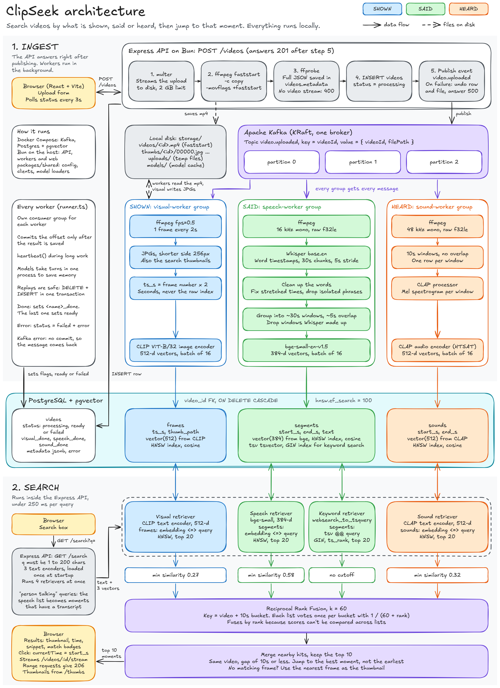

# ClipSeek

[](https://github.com/KumarAyushh/ClipSeek/actions/workflows/ci.yml)

**Grep for videos.** Search inside your videos by what is shown, said or heard, and jump straight to that moment.

Type *"dog barking"*, *"white church with blue domes"* or *"going to the moon because it is hard"* and get back the video and the exact timestamp. The player jumps there. Everything runs locally on open models, with no cloud APIs and no API keys.

<!-- DEMO GIF: record it, save it as docs/demo.gif, then replace this comment with:

-->

## Highlights

- **Multimodal search.** CLIP finds what is on screen, Whisper and bge-small find what is said, CLAP finds what is heard, and Postgres full-text catches exact words. Reciprocal Rank Fusion merges the four result lists into one ranked list of moments.
- **Event-driven pipeline.** One Kafka event fans out to three independent consumer groups. The API answers right after publishing and never waits on a model.
- **Reliable by design.** Workers are idempotent and commit offsets only after their results are saved, so a crashed worker's video is redelivered and finished instead of lost.
- **Measured, not assumed.** Recall@5 of **0.85** and MRR of **0.73** on 33 labeled queries (0.75–0.82 recall on held-out splits), plus 8 queries with no right answer to catch false matches.
- **Fast on a laptop.** Searches take under 250 ms on a CPU, with no GPU.
- **Tested.** 61 unit tests, strict TypeScript, and CI on every push.

## Architecture

[](docs/architecture.png)

*Click the image for the full-size version.*

| Decision | Why |
|---|---|
| Three Kafka consumer groups on one topic | Each worker gets every video and can fail, restart or scale on its own. Three partitions let copies of a worker share the load. |
| PostgreSQL + pgvector | One database holds metadata, vectors and full-text search, so there is no separate vector store to run. |
| Reciprocal Rank Fusion | Cosine similarity and `ts_rank` are on different scales. Fusing by rank works without comparing them. |
| A similarity cutoff per retriever | Vector search always returns its top 20, even for nonsense. RRF rewards rank, so weak hits have to be removed first. |
| CLAP on 10s windows at 48 kHz | One vector for a whole soundtrack can't point to a moment. |
| Whisper word timestamps | Phrase timestamps have no gaps, so silence gets counted as speech. Word timestamps put a phrase that starts at 8s at 8.72s, not 0s. |

## How it works

**1. Upload.** The API streams the file to disk, makes it seekable with `ffmpeg -c copy -movflags +faststart` (no re-encode), stores the full ffprobe metadata as `jsonb`, and publishes `video.uploaded`.

**2. Index.** Each worker processes the video on its own and writes its own table. The video becomes `ready` when all three finish.

| Worker | Captures | Pipeline | Stored in |
|---|---|---|---|
| Visual | What is shown | 1 frame every 2s → CLIP ViT-B/32 image encoder | `frames`, 512-d |
| Speech | What is said | 16 kHz audio → Whisper base.en → ~30s windows with ~5s overlap → bge-small-en-v1.5 | `segments`, 384-d + `tsvector` |
| Sound | What is heard | 48 kHz audio → 10s windows → CLAP audio encoder | `sounds`, 512-d |

**3. Search.** The query runs through four retrievers at once: CLIP text → `frames`, bge → `segments`, full-text → `segments`, and CLAP text → `sounds`. Each list is cut off at its own minimum score, fused with RRF (k = 60) on video + 10s bucket, and merged into the top 10 moments.

**4. Watch.** Clicking a result seeks the player to that moment. HTTP range requests mean only the needed part of the file is sent.

## Results

### Search quality

Evaluated on 6 real videos (29 minutes of speeches, narration, animation and recorded sounds) with 11 other test videos as distractors. A result only counts if the player lands inside the expected time range or up to 15s before it, so these numbers measure the jump and not just the video.

| Version | Recall@5 | MRR | No-answer queries with no false match |
|---|---|---|---|
| Baseline | 0.67 | 0.52 | 2 of 8 |
| Raised `hnsw.ef_search`, jump to the best moment | 0.82 | 0.69 | 1 of 8 |
| Re-tuned cutoffs on real footage | **0.85** | **0.73** | **6 of 8** |

The final cutoffs were tuned on these same queries. Tuning on one half and testing on the other gave Recall@5 of 0.75–0.82 and MRR of 0.72–0.73, which is the fairer estimate for unseen queries.

| Query type | Queries | Recall@5 |
|---|---|---|
| Speech | 11 | 0.91 |
| Sound | 8 | 0.88 |
| Visual | 11 | 0.82 |
| Keyword | 3 | 0.67 |

Every retriever earns its place: removing any one of them lowers recall from 0.85. Keyword adds the least here, partly because only 3 queries depend on exact words.

| Retriever removed | Recall@5 |
|---|---|
| Visual | 0.64 |
| Speech | 0.67 |
| Sound | 0.73 |
| Keyword | 0.82 |

### Processing time

Measured on a laptop CPU (Ryzen 5 5600U, 7.6 GB RAM, WSL2) with all three workers sharing one process.

| Video | Length | Frames | Transcript windows | Sound windows | Visual | Speech | Sound |
|---|---|---|---|---|---|---|---|
| JFK Rice speech | 300s | 150 | 12 | 30 | 19s | 184s | 15s |
| Duck and Cover | 555s | 278 | 21 | 56 | 31s | 391s | 26s |
| Big Buck Bunny | 300s | 150 | 0 | 30 | 15s | 198s | 13s |
| Sintel | 300s | 150 | 5 | 30 | 16s | 140s | 13s |

A 5-minute video takes 3 to 4 minutes end to end, and nearly all of that is Whisper.

## Engineering challenges

**Text queries were missing obvious frames.** *"White church with blue domes"* couldn't find frames of the church. An exact scan showed why: at pgvector's default `ef_search` of 40, the HNSW index returned 84% of the true top 20 on average and 0% on the worst query, because text vectors sit far from the graph of image vectors. Nothing crashed; results just got quietly worse. At 100 it matched the exact scan on all 41 queries. Together with a fix to the jump target, visual recall rose from 0.64 to 0.91 before the final cutoff tuning.

**Whisper invents text on music and silence.** It produced 572 words for Big Buck Bunny, which has no dialogue. In a test video, one made-up word lasting 28s pulled the start of a real talk 28s too early. Made-up windows turned out to have 50–100% zero-length words, against 0–10% for real speech. Capping word length, dropping isolated phrases and rejecting windows at the 50% mark took Big Buck Bunny to 0 transcript rows and fixed the jump times.

**Workers were being killed for running out of memory.** Testing each suspect alone found the real causes. Bun's subprocess pipe peaked at 2,410 MB for 55 MB of audio, against 91 MB with a temp file. Model tensors live in native memory that the garbage collector can't see, so a timed GC and turning off the ONNX arena were needed too. Four 5-minute videos in a row now leave memory where it started (1,607 MB before, 1,630 MB after).

**Failures are safe to retry.** Each worker replaces a video's rows in one transaction and commits its Kafka offset only after the outcome is saved. A bad video is marked `failed` with its error, and a Kafka error leaves the message to be delivered again. Replaying messages and killing workers mid-video both ended with correct data.

## Limitations

- **Speech jumps can be early.** A speech result jumps to the start of its ~30s window, so it can land up to about 30s before the phrase.
- **Some false matches remain.** *"Football match"* still matches, because CLAP hears the crowd in the JFK speech. Cutoff margins are thin, and the values are rough on this small a query set.
- **The eval set is small.** 33 queries on 6 videos is enough to compare versions of this project, not to predict results on any video. Labels come from word timestamps, contact sheets and clip boundaries, and haven't been checked by ear.
- **Whisper's made-up text can slip through.** Mixed windows can keep some invented words, and mostly invented windows can take real words with them. Speech search is English only.
- **It needs real memory and time.** Workers peak at about 2.7 GB, and processing is CPU-only.
- **Some formats don't work.** VP8 `.webm` files are rejected with a clear error because there is no re-encode fallback, and a codec the browser can't play may upload but not play.
- **It's a single-machine app.** There is no authentication, files live on local disk, and a video whose worker is killed stays `processing` until the workers restart.

## Run it locally

**Requirements:** [Bun](https://bun.sh) 1.3 or later, Docker, ffmpeg, and at least 8 GB of RAM. The first start downloads the four models (about 1.6 GB) into `storage/models/`.

```bash
git clone https://github.com/KumarAyushh/ClipSeek.git
cd ClipSeek
cp .env.example .env        # then fill it in, see below
bun install
docker compose up -d --wait # Postgres + Kafka
bun run db:migrate          # create tables and indexes
bun run kafka:setup         # create the video.uploaded topic (3 partitions)
bun run dev                 # API, workers and web app
```

Open <http://localhost:5173> once the API and workers have loaded their models.

Use these values in `.env`, choosing your own Postgres user, password and database name:

```env
POSTGRES_USER=<your-user>
POSTGRES_PASSWORD=<your-password>
POSTGRES_DB=<your-database>
DATABASE_URL=postgres://<your-user>:<your-password>@localhost:5433/<your-database>

KAFKA_BROKERS=localhost:9092
KAFKA_TOPIC_VIDEO_UPLOADED=video.uploaded
STORAGE_DIR=./storage
API_PORT=3000

CLIP_MODEL=Xenova/clip-vit-base-patch32
WHISPER_MODEL=Xenova/whisper-base.en
TEXT_EMBED_MODEL=Xenova/bge-small-en-v1.5
CLAP_MODEL=Xenova/clap-htsat-unfused
```

| Command | What it does |
|---|---|
| `bun test` | Run the unit tests (no database, Kafka or models needed) |
| `bun run typecheck` | Type-check every package |
| `bun run eval` | Print Recall@5 and MRR. Needs the API running and the videos in `eval/queries.json` indexed |

`bun run dev` keeps all three workers in one process, where the models take turns to save memory. To run them in parallel, start each in its own terminal with `bun run start visual`, `speech` or `sound` from `apps/workers`.

## Tech stack

| Layer | Tools |
|---|---|
| Backend | Bun, TypeScript, Express, kafkajs |
| Messaging | Apache Kafka (KRaft) |
| Database | PostgreSQL, pgvector (HNSW), full-text search (GIN) |
| Media | ffmpeg, ffprobe |
| Models (local, via transformers.js) | CLIP ViT-B/32, Whisper base.en, bge-small-en-v1.5, CLAP HTSAT |
| Frontend | React, Vite, Tailwind CSS |
| Tooling | Turborepo, Docker Compose, GitHub Actions, `bun test` |

## API

| Method | Route | Purpose |
|---|---|---|
| `POST` | `/videos` | Upload a video (multipart, field `video`) |
| `GET` | `/videos` | List videos and their status |
| `GET` | `/videos/:id` | One video with its full metadata |
| `DELETE` | `/videos/:id` | Remove a video and everything made from it |
| `GET` | `/videos/:id/stream` | Stream the video, with range requests |
| `GET` | `/search?q=` | Search. Add `debug=1` for raw lists, cutoffs and timings |
| `GET` | `/health` | Check the API and its database connection |

## Project layout

```
apps/api         Express API: upload, streaming, search and fusion
apps/workers     Kafka consumers: visual, speech and sound
apps/web         React frontend
packages/shared  Config, database and Kafka clients, model loaders
migrations/      SQL schema
scripts/         Migration runner and Kafka topic setup
eval/            Labeled queries and the Recall@5 / MRR script
docs/            Architecture diagram
```

## What's next

- Store word times with each transcript window, so speech results jump to the exact phrase
- Add a Kafka retry topic and dead-letter queue for videos that fail
- Sample frames on scene changes instead of a fixed interval
- Support languages other than English

## Credits

Models: [CLIP](https://github.com/openai/CLIP), [Whisper](https://github.com/openai/whisper), [BGE](https://github.com/FlagOpen/FlagEmbedding) and [CLAP](https://github.com/LAION-AI/CLAP), run through [Transformers.js](https://github.com/huggingface/transformers.js). Evaluation videos are public domain or Creative Commons, including *Big Buck Bunny* and *Sintel* by the Blender Foundation (CC BY 3.0). They aren't included in this repo; sources and licenses are listed in [`eval/queries.json`](eval/queries.json).
